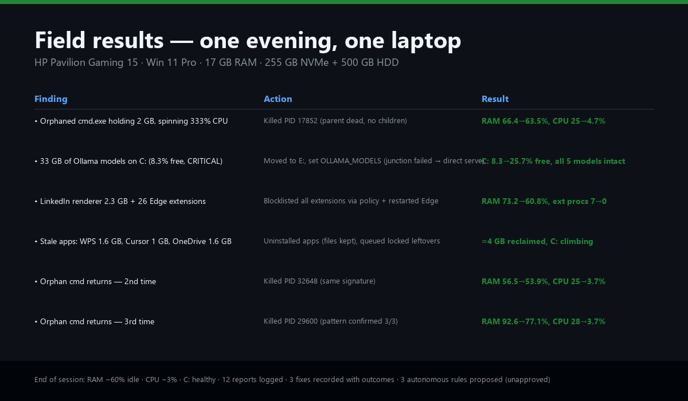

# PC Performance Monitor

**A report-first Windows PC monitoring agent that learns which fixes actually worked — and proposes autonomous rules that only you can approve.**

Built for [OpenCode](https://opencode.ai) as a skill (`SKILL.md`), with standalone scripts that also run without any agent.

# PC Performance Monitor

[](LICENSE)
[](https://github.com/YOUR_USERNAME/pc-performance-monitor)
[](https://www.python.org)
[](SECURITY.md)
[](https://github.com/YOUR_USERNAME/pc-performance-monitor)
[](https://github.com/YOUR_USERNAME/pc-performance-monitor/releases)

**A report-first Windows PC monitoring agent that learns which fixes actually worked — and proposes autonomous rules that only you can approve.**

Built for [OpenCode](https://opencode.ai) as a skill (`SKILL.md`), with standalone scripts that also run without any agent.



---

## Table of contents

- [Why this exists](#why-this-exists)
- [How it works](#how-it-works)
- [Quickstart](#quickstart)
- [Command reference](#command-reference)
- [Scheduling](#scheduling)
- [Understanding the report](#understanding-the-report)
- [The learning loop](#the-learning-loop)
- [Autonomous rules (gated)](#autonomous-rules-gated)
- [Stale watch (unused apps & files)](#stale-watch-unused-apps--files)
- [Security & safety contract](#security--safety-contract)
- [Project structure](#project-structure)
- [Troubleshooting](#troubleshooting)
- [FAQ](#faq)
- [Contributing](#contributing)
- [License](#license)
- [Changelog](#changelog)

---

## Why this exists

Windows PCs slow down for predictable reasons — orphaned processes, browser tab bloat, full disks, startup app creep — but diagnosing them is manual and repetitive. This tool automates the diagnosis, **logs every decision**, and **learns which fixes actually worked** so the next time the same problem appears, it suggests the proven fix.

Unlike generic "PC cleaner" tools, this one:
- **Never deletes, uninstalls, or kills anything without your approval**
- **Remembers** what you did and whether it helped (SQLite history)
- **Proposes** autonomous rules from successful fixes — but they stay inert until you explicitly approve them
- **Reports first** — every check produces a timestamped report before any action

---

## How it works

```
every 1h:  check  →  report  →  notify  →  recall past fixes
                                             ↓
you:       act  →  outcome (worked? yes/no)
                                             ↓
agent:     propose rules (inert)  →  you approve  →  apply (logged)
```

1. **Monitor** — collects RAM/CPU totals, top processes, windowless background ranking, headless-browser flag (app alive with zero windows), disk health + free space, uptime.
2. **Report** — writes a timestamped, structured report to `performance_report.txt` and logs to SQLite.
3. **Notify** — desktop toast with a one-line summary.
4. **Recall** — surfaces past fixes for the same issue kind + their success rates.
5. **Learn** — you log what you did (`act`) and whether it worked (`outcome`). This becomes the training data.
6. **Propose** — after enough resolved history, derives rule candidates. Stored **unapproved** — inert.
7. **Approve** — you review and approve (or reject) each proposal.
8. **Apply** — executes one approved rule, logs action + outcome automatically.

---

## Try it now (no setup needed)

Want to see what it does before installing? Run the lightweight check (no database, no setup):

```powershell
cd pc-performance-monitor
pip install psutil plyer
python scripts\monitor.py
```

This prints a one-shot report to your terminal. No files written, no DB created. If you like it, run `init` to start the full learning loop.

---

## Quickstart

### Prerequisites
- Windows 10 or 11
- Python 3.10+ (or PowerShell 5.1+ for the PS-only fallback)
- `pip install psutil plyer`

### Install

```powershell
git clone https://github.com/YOUR_USERNAME/pc-performance-monitor.git
cd pc-performance-monitor
pip install psutil plyer
```

### First run

```powershell
# Create the history DB with sample data (only seeds on empty DB)
python scripts\perf_agent.py init

# Run one check (appends to performance_report.txt, logs to DB, sends toast)
python scripts\perf_agent.py check --top 5

# Review what was found
python scripts\perf_agent.py history --limit 3
```

### Log your first fix

```powershell
# After you fix something (e.g., killed a process), log it:
python scripts\perf_agent.py act --suggestion 1 --action "killed orphaned cmd PID 1234"

# Then log whether it worked:
python scripts\perf_agent.py outcome --action 1 --worked 1 --note "RAM 66->63%" --ram-before 66 --ram-after 63
```

### Look up past cases

```powershell
python scripts\perf_agent.py recall --kind heavy_ram --detail cmd.exe
python scripts\perf_agent.py history --limit 10
```

### Propose autonomous rules (after 1+ resolved fix)

```powershell
python scripts\perf_agent.py propose
python scripts\perf_agent.py rules
# Review proposals, then approve individually:
python scripts\perf_agent.py approve-rule 2
```

---

## Command reference

| Command | Purpose |
|---|---|
| `init` | Create DB (+ sample history on empty DB) |
| `check [--top N] [--auto]` | Monitor, log, recall, notify |
| `act --suggestion ID --action "..."` | Log your chosen action |
| `outcome --action ID --worked 0\|1 [--note ...] [--ram-before X] [--ram-after Y]` | Log the result (the learning signal) |
| `history [--limit N]` | Past reports → suggestions → actions → outcomes |
| `recall --kind K [--detail T]` | Similar cases + success rates |
| `propose` | Derive rule candidates (stored unapproved) |
| `approve-rule ID` | Approve a rule (human only) |
| `rules` | List rules + approval state |
| `apply ID` | Execute one approved rule (logged) |
| `stale [--min-mb 100] [--home PATH]` | Unused-app / untouched-file audit |
| `watch [--threshold 87] [--clear 82]` | RAM tripwire (single-shot, for 5-min scheduler) |

### Suggestion kinds
`heavy_ram`, `cpu_hog`, `headless_app`, `disk_critical`, `disk_low`, `ram_high`, `ok`

### Common flags
| Flag | Default | Description |
|---|---|---|
| `--db PATH` | `./performance_history.db` | SQLite history database |
| `--report PATH` | `./performance_report.txt` | Report file (append-only) |
| `--top N` | `5` | Number of top processes to show |
| `--min-mb N` | `100` | Minimum file size (MB) for stale audit |
| `--home PATH` | auto-detected | Profile root for stale audit |
| `--auto` | off | Execute approved rules headlessly (use with caution) |
| `--threshold N` | `87` | RAM % to trigger tripwire alert |
| `--clear N` | `82` | RAM % to clear tripwire alert |

---

## Scheduling

### Hourly check (report + log + suggest; never executes)

```powershell
schtasks /Create /TN "PC Performance Monitor Py" /TR "<repo>\run\check.bat" /SC HOURLY /MO 1 /F
```

### Weekly stale audit (Sundays 04:00)

```powershell
schtasks /Create /TN "PC Stale Audit" /TR "<repo>\run\stale.bat" /SC WEEKLY /D SUN /ST 04:00 /F
```

### 5-minute RAM tripwire

```powershell
schtasks /Create /TN "PC RAM Watch" /TR "<repo>\run\watch.bat" /SC MINUTE /MO 5 /F
```

> **Important:** `schtasks /TR` is limited to 261 characters. Always use the `.bat` wrappers in `run\` — never inline the full Python command. Edit the paths inside the `.bat` files to match your setup.

### Remove scheduled tasks

```powershell
schtasks /Delete /TN "PC Performance Monitor Py" /F
schtasks /Delete /TN "PC Stale Audit" /F
schtasks /Delete /TN "PC RAM Watch" /F
```

### Verify tasks

```powershell
schtasks /Query /TN "PC Performance Monitor Py" /V /FO LIST
```

---

## Understanding the report

Each check appends a block like this to `performance_report.txt`:

```
===== 2026-10-26 12:40:02 =====
RAM: 15.75 GB used / 17.01 GB total (92.6%) | Free: 1.27 GB
CPU (total): 28.5% (avg load)
--- Top 5 RAM ---
cmd.exe PID=29600 2082 MB (12.8%) CPU=300.3%
msedge.exe PID=19404 913 MB (5.6%) CPU=0.0%
...
--- Top 5 CPU ---
cmd.exe PID=29600 CPU=300.3% RAM=2082 MB
...
--- Background (no window, top 5) ---
cmd.exe PID=29600 2082 MB (12.8%)
...
--- Disks ---
C:\ 39.9 GB free / 254.9 GB (15.7% free) [OK]
E:\ 100.6 GB free / 268.4 GB (37.5% free) [OK]
Uptime: 7 days 23h 6m (since 2026-10-18 13:33:15)
Suggestions: HIGH RAM (>85%): close top RAM apps... | Heavy app: cmd.exe (PID 29600) uses 12.8% RAM (2082 MB) - verify, then close/restart. | CPU hog: cmd.exe (PID 29600) at 300.3% - verify what it is first.
----------------------------------------
```

### What each section means

| Section | What it tells you |
|---|---|
| RAM line | Used/total GB, percentage, free GB |
| CPU (total) | Average CPU load percentage |
| Top N RAM | Processes ranked by RAM usage (MB + %) |
| Top N CPU | Processes ranked by CPU time |
| Background (no window) | Windowless processes using the most RAM — the ones you can't see |
| Disks | Free/total GB, percentage, status (OK / LOW <15% / CRITICAL <10%) |
| Uptime | Days/hours since last boot |
| Suggestions | Evidence-based recommendations (never auto-applied) |

---

## The learning loop

The agent gets smarter over time through a simple feedback loop:

1. **Check** produces suggestions with a `kind` + `detail` (e.g., `heavy_ram` / `cmd.exe`)
2. **You act** (`act --suggestion N --action "..."`) — logs what you did
3. **You report back** (`outcome --action N --worked 1 --ram-before X --ram-after Y`) — logs whether it helped
4. **Recall** — next time the same kind+detail appears, the agent shows past fixes + success rates
5. **Propose** — after 1+ successful fix for a pattern, the agent proposes an autonomous rule
6. **You approve** — `approve-rule N` (human decision, never automatic)
7. **Apply** — `apply N` executes the rule and logs the outcome

### Example: orphan cmd.exe

```
Check 1: cmd.exe 2 GB, 333% CPU → suggestion #1 (heavy_ram/cmd.exe)
You:     act --suggestion 1 --action "Killed PID 17852 (parent dead, no children)"
You:     outcome --action 1 --worked 1 --ram-before 66.4 --ram-after 63.5
Check 2: cmd.exe 2 GB, 300% CPU → recall shows "1/1 successful: Killed PID 17852"
You:     act --suggestion 2 --action "Killed PID 32648 (same pattern)"
You:     outcome --action 2 --worked 1 --ram-before 56.5 --ram-after 53.9
Check 3: cmd.exe 2 GB, 300% CPU → recall shows "2/2 successful"
Agent:   propose → rule #2: when heavy_ram/cmd.exe → kill_by_name cmd.exe (worked 2/2)
You:     approve-rule 2
Agent:   (now auto-kills orphan cmd.exe on next check, if --auto is enabled)
```

---

## Autonomous rules (gated)

### Safety layers

1. **Propose** — rules are derived from history (worked ≥1). Stored as `approved=0` (inert).
2. **Review** — you see the condition, action, and basis (`worked N/M`). You approve, edit, or reject.
3. **Approve** — `approve-rule ID` only on explicit user action. Never automatic.
4. **Suggest-only** — approved rules still only suggest in interactive `check` mode. You say "apply N" to execute.
5. **Headless execution** — requires `--auto` flag on the scheduled task (opt-in, off by default).
6. **Never-kill list** — system processes (System, Registry, smss.exe, csrss.exe, wininit.exe, services.exe, lsass.exe, dwm.exe, explorer.exe, System Idle Process) can never be killed, even by approved rules.

### Rule types

| Type | Behavior |
|---|---|
| `kill_by_name` | Terminates matching processes over the RAM threshold (refuses never-kill names) |
| `suggest` | Surfaces the proven fix as a suggestion (no auto-action) |

---

## Stale watch (unused apps & files)

The `stale` command audits:

### Unused apps (90+ days)
- Scans Windows Uninstall registry (HKLM + HKCU, 32/64-bit)
- Cross-references with Prefetch file mtimes and Explorer UserAssist (ROT13-decoded)
- Filters out redistributables, security dependencies, and currently-running apps
- Reports apps with no run evidence + estimated size

### Untouched files (180+ days, ≥100 MB)
- Scans Documents, Downloads, Desktop, Videos, Pictures, OneDrive
- Uses last-write time (Windows disables last-access tracking by default)
- Skips caches, node_modules, .git, AppData, Ollama models
- Reports file path, size, and last-modified date

### Caveats
- "No run evidence" means unverified, not proven-unused (portable/store apps leave weak traces)
- Redistributables and security dependencies are never suggested for removal
- File "untouched" uses last-write time, not last-open time

### Run manually
```powershell
python scripts\stale_audit.py --min-mb 100 --out stale_report.json
```

### Refresh via scheduler
The weekly `stale` task refreshes `stale_report.json`. Each `check` reads the cached results and shows top candidates.

---

## Security & safety contract

### What the tool does NOT do
- ❌ Never deletes, uninstalls, or modifies files
- ❌ Never modifies the registry (documents how, but doesn't execute)
- ❌ Never makes network calls (no telemetry, no phone-home)
- ❌ Never kills system processes (hardcoded never-kill list)
- ❌ Never acts without approval (report first, always)
- ❌ Never stores secrets or credentials

### What the tool DOES do
- ✅ Reads system metrics (RAM, CPU, processes, disks)
- ✅ Reads installed apps and file metadata (read-only)
- ✅ Appends to text reports and SQLite databases
- ✅ Sends desktop notifications (via plyer)
- ✅ Terminates user-approved processes (only via `apply` on approved rules)

### Dependencies
| Package | Version | Source | Trust |
|---|---|---|---|
| psutil | 7.2.2 | PyPI | Widely used (~10M downloads/month) |
| plyer | 2.1.0 | PyPI | Well-known desktop notification library |
| PowerShell built-ins | system | Microsoft | Trusted |

No third-party or obscure dependencies. All other imports are Python stdlib.

### Security audit
A full security audit is available in `SECURITY.md` (or `security_audit.md` in the repo root).

---

## Project structure

```
pc-performance-monitor/
├── SKILL.md                 # agent instructions (OpenCode skill)
├── README.md                # this file
├── LICENSE                  # MIT
├── .gitignore               # excludes runtime data
├── SECURITY.md              # security audit report
├── CONTRIBUTING.md          # contributing guide
├── CHANGELOG.md             # version history
├── scripts/
│   ├── perf_agent.py        # main agent: monitor + learn + propose
│   ├── stale_audit.py       # unused-app / untouched-file audit
│   ├── monitor.py           # lightweight check (no DB)
│   └── monitor.ps1          # PowerShell fallback (no Python needed)
└── run/
    ├── check.bat            # hourly task wrapper (edit paths!)
    ├── stale.bat            # weekly task wrapper (edit paths!)
    └── watch.bat            # 5-min RAM tripwire wrapper (edit paths!)
```

### Runtime files (gitignored, created at runtime)
| File | Purpose |
|---|---|
| `performance_report.txt` | Append-only timestamped reports |
| `performance_history.db` | SQLite: reports, suggestions, actions, outcomes, rules |
| `stale_report.json` | Cached stale audit results |
| `ram_watch_state.json` | Tripwire breach state |

---

## Troubleshooting

### "psutil not installed"
```powershell
pip install psutil plyer
```

### "The system cannot find the file specified" (scheduled task)
The `.bat` wrapper paths are wrong. Edit `run\check.bat` and update the Python + script paths to match your installation.

### "schtasks /TR cannot be more than 261 characters"
Always use `.bat` wrappers. Never inline the full Python command in `/TR`.

### Task shows "Ready" but never runs
- Check "Run only when user is logged on" vs "Run whether user is logged on"
- Verify the `.bat` file exists at the path in the task
- Test by running the `.bat` manually first

### Report shows "No action needed" but RAM is high
The agent only suggests actions when thresholds are crossed (RAM ≥75%, disk <15%, process >10% RAM, CPU >20%). If nothing crosses, it reports "No action needed" — which is correct.

### Stale audit shows "no evidence" for everything
Prefetch and UserAssist data may be cleared by privacy tools or recent Windows updates. The audit is best-effort — "no evidence" means unverified, not proven-unused. Cross-reference with your actual usage.

### Extensions blocked in Edge
The skill documents Edge policy commands but doesn't execute them automatically. If you ran them manually and want to revert:
```powershell
reg delete "HKCU\Software\Policies\Microsoft\Edge\ExtensionInstallBlocklist" /f
reg delete "HKCU\Software\Policies\Microsoft\Edge\ExtensionInstallAllowlist" /f
```

---

## FAQ

**Q: Does this tool send data anywhere?**
A: No. Zero network calls. All data stays in local files on your machine.

**Q: Can it damage my PC?**
A: No. It only reads metrics and writes reports/logs. It never deletes, uninstalls, or modifies anything. Destructive actions (like killing processes) require explicit approval and are logged with outcomes.

**Q: Does it work on Windows 10?**
A: Yes. Tested on Windows 11, should work on Windows 10 with Python 3.10+.

**Q: Can I use it without OpenCode?**
A: Yes. The scripts work standalone. `SKILL.md` is for OpenCode integration; the scripts work from any terminal.

**Q: How much disk space does it use?**
A: The scripts are ~50 KB. Runtime data (report + DB + stale cache) grows slowly — expect <5 MB after a year of hourly checks.

**Q: Can I change the RAM threshold?**
A: Yes. Edit the `watch.bat` wrapper to change `--threshold 87 --clear 82`. The `check` command's suggestion thresholds are in `perf_agent.py` (search for `>= 85` and `>= 75`).

**Q: What if I want to reset everything?**
A: Delete `performance_report.txt`, `performance_history.db`, `stale_report.json`, and `ram_watch_state.json`. Run `init` to start fresh.

---

## Contributing

See [CONTRIBUTING.md](CONTRIBUTING.md) for detailed guidelines.

Issues and PRs welcome. Please keep the safety contract:
- Report first, approvals stay human
- Destructive actions stay logged with outcomes
- System processes never killed
- No network calls, no telemetry

### Development setup
```powershell
git clone https://github.com/YOUR_USERNAME/pc-performance-monitor.git
cd pc-performance-monitor
pip install psutil plyer
python scripts\perf_agent.py init
python scripts\perf_agent.py check --top 5
```

### Running tests
```powershell
python -m py_compile scripts\perf_agent.py scripts\stale_audit.py scripts\monitor.py
python scripts\perf_agent.py check --top 5
python scripts\perf_agent.py stale --min-mb 100
```

---

## Field results

From one evening of real usage on an HP Pavilion Gaming 15 (Win 11, 17 GB RAM, 255 GB NVMe + 500 GB HDD):


| # | Finding | Action | Result |
|---|---|---|---|
| 1 | Orphaned `cmd.exe` 2 GB, 333% CPU | Killed PID (parent dead, no children) | RAM 66.4→63.5%, CPU 25→4.7% |
| 2 | 33 GB Ollama models on C: (8.3% free) | Moved to E:, set `OLLAMA_MODELS` | C: 8.3→25.7% free, all 5 models intact |
| 3 | LinkedIn renderer 2.3 GB + 26 extensions | Blocklisted extensions, restarted Edge | RAM 73.2→60.8%, ext procs 7→0 |
| 4 | Stale audit: WPS 1.6 GB, Cursor 1 GB, OneDrive 1.6 GB, Mafia II ISO 3.1 GB, ~14 GB old recordings | Uninstalled apps (files kept) | C: →25.7% free and climbing |
| 5 | Orphan cmd returns (2nd time) | Killed PID (same pattern) | RAM 56.5→53.9%, CPU 25→3.7% |
| 6 | Orphan cmd returns (3rd time) | Killed PID (pattern confirmed 3/3) | RAM 92.6→77.1%, CPU 28→3.7% |

End of session: RAM ~60% idle, CPU ~3%, C: healthy, 12+ reports logged, 6 fixes recorded with outcomes, 3 autonomous rules proposed (unapproved).

---

## License

MIT — see [LICENSE](LICENSE).

---

## Versions

| Version | Date | Highlights |
|---|---|---|
| 1.0.0 | 2026-10-26 | Initial release: report-first monitor, learning loop, gated autonomy, stale watch, RAM tripwire, Edge policy docs |

See [CHANGELOG.md](CHANGELOG.md) for full details.

---

*Built with [OpenCode](https://opencode.ai) · Tested on Windows 11 Pro · Python 3.14*
